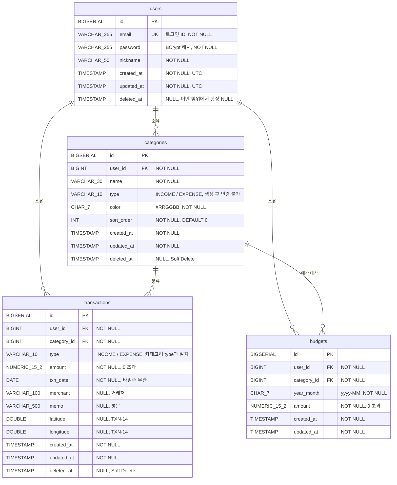

# 포켓로그(PocketLog) ERD

> **버전** 1.0 · **최종 수정** 2026-09-21
> 이 문서는 `CLAUDE.md` 4장(데이터 모델)을 **그림과 표로 다시 정리한 파생 문서**다.
> **스키마의 정본은 `CLAUDE.md` 4장이다.** 이 문서와 충돌하면 `CLAUDE.md`가 이긴다. 스키마를 바꾸면 `CLAUDE.md` → 이 문서 순서로 고친다.
>
> 관련 문서: `CLAUDE.md` 4장(스키마 정본) · `docs/PRD.md`(요구사항) · `docs/ROADMAP.md` Phase 2(구현·DoD)

---

## 1. 한눈에 보기

- **테이블 4개**: `users` · `categories` · `transactions` · `budgets`
- DB: PostgreSQL, 스키마명 `moneylog_db`(테스트 `moneylog_test`)
- **모든 데이터는 `user_id`로 사용자에게 귀속**된다. 다른 사용자의 행에 접근하면 404를 반환한다(존재 여부 노출 방지).
- **Soft Delete**: `categories`·`transactions`만. **`budgets`는 물리 삭제**(행 제거 = 예산 미설정).
- 금액은 전부 `NUMERIC(15,2)` / `BigDecimal`. 부호는 `type`으로만 표현하고 `amount > 0`이다.

---

## 2. ERD



> 다이어그램의 `_`(예: `VARCHAR_255`)는 Mermaid 문법 제약 때문이며 실제 타입은 `VARCHAR(255)`다.
> `users` 한 명이 세 테이블 모두의 상위이고, `categories`가 `transactions`·`budgets`의 공통 상위다. **순환 참조는 없다.**

---

## 3. 테이블 정의

### 3.1 `users`

| 컬럼 | 타입 | 제약 | 비고 |
|---|---|---|---|
| id | BIGSERIAL | PK | |
| email | VARCHAR(255) | UNIQUE, NOT NULL | 로그인 ID. 형식 검증 |
| password | VARCHAR(255) | NOT NULL | BCrypt. 평문 6자 이상 + UTF-8 72바이트 이하 |
| nickname | VARCHAR(50) | NOT NULL | 1~50자. `PUT /auth/me`로 변경 |
| created_at | TIMESTAMP | NOT NULL | UTC, Auditing |
| updated_at | TIMESTAMP | NOT NULL | UTC, Auditing |
| deleted_at | TIMESTAMP | NULL | **항상 NULL.** 회원 탈퇴가 비목표. 로그인·인증 시 `deleted_at IS NULL` 검사는 유지 |

- `provider`·`provider_id`를 **만들지 않는다.** 구글 로그인이 범위 밖이다.
- `email` UNIQUE는 Soft Delete 충돌 대상이 아니다(`deleted_at`이 채워지는 경로가 없다).

### 3.2 `categories`

| 컬럼 | 타입 | 제약 | 비고 |
|---|---|---|---|
| id | BIGSERIAL | PK | |
| user_id | BIGINT | FK → users.id, NOT NULL | |
| name | VARCHAR(30) | NOT NULL | 1~30자 |
| type | VARCHAR(10) | NOT NULL | `INCOME` / `EXPENSE`. **생성 후 변경 불가** |
| color | CHAR(7) | NOT NULL | `#RRGGBB` 정규식 검증 |
| sort_order | INT | NOT NULL, DEFAULT 0 | 목록은 `sort_order ASC, id ASC` |
| created_at | TIMESTAMP | NOT NULL | |
| updated_at | TIMESTAMP | NOT NULL | |
| deleted_at | TIMESTAMP | NULL | Soft Delete |

### 3.3 `transactions`

| 컬럼 | 타입 | 제약 | 비고 |
|---|---|---|---|
| id | BIGSERIAL | PK | |
| user_id | BIGINT | FK → users.id, NOT NULL | |
| category_id | BIGINT | FK → categories.id, NOT NULL | 삭제된 카테고리도 참조 가능 |
| type | VARCHAR(10) | NOT NULL | `INCOME` / `EXPENSE`. **카테고리 type과 일치해야 함** |
| amount | NUMERIC(15,2) | NOT NULL, **> 0** | 최대 9,999,999,999,999.99 |
| txn_date | DATE | NOT NULL | 시각 없음 → 타임존 영향 없음 |
| merchant | VARCHAR(100) | NULL | 거래처/상호. 고정지출 감지의 키 |
| memo | VARCHAR(500) | NULL | 평문(HTML 아님) |
| latitude | DOUBLE | NULL | `TXN-14`. 카카오맵 팝업에서 고른 지점만 |
| longitude | DOUBLE | NULL | `TXN-14`. latitude와 **함께** 채워지거나 함께 NULL |
| created_at | TIMESTAMP | NOT NULL | |
| updated_at | TIMESTAMP | NOT NULL | |
| deleted_at | TIMESTAMP | NULL | Soft Delete |

- `latitude`/`longitude`는 서버가 지오코딩하지 않으며 DTO 범위 검증도 없다(값의 출처가 자유 입력이 아니다).
- `PUT`은 전체 교체이므로 `merchant`·`memo`·`latitude`·`longitude`를 누락하면 NULL로 저장된다.

### 3.4 `budgets`

| 컬럼 | 타입 | 제약 | 비고 |
|---|---|---|---|
| id | BIGSERIAL | PK | |
| user_id | BIGINT | FK → users.id, NOT NULL | |
| category_id | BIGINT | FK → categories.id, NOT NULL | |
| year_month | CHAR(7) | NOT NULL | `yyyy-MM`. 문자열 정렬 = 시간 정렬 |
| amount | NUMERIC(15,2) | NOT NULL, **> 0** | |
| created_at | TIMESTAMP | NOT NULL | |
| updated_at | TIMESTAMP | NOT NULL | |

- **`deleted_at` 없음.** 예산을 0 또는 null로 저장하면 **행을 물리 삭제**한다(미설정 상태로 복귀). 이 프로젝트에서 물리 삭제를 허용하는 유일한 테이블이다.
- `PUT /budgets`가 upsert이므로 `(user_id, category_id, year_month)` UNIQUE가 upsert의 기준 키다.

---

## 4. 관계

| 부모 | 자식 | 카디널리티 | FK | 삭제 시 동작 |
|---|---|---|---|---|
| users | categories | 1 : N | `categories.user_id` | 사용자 삭제 경로 없음 |
| users | transactions | 1 : N | `transactions.user_id` | 〃 |
| users | budgets | 1 : N | `budgets.user_id` | 〃 |
| categories | transactions | 1 : N | `transactions.category_id` | **Soft Delete라 FK가 깨지지 않는다.** 거래가 있는 카테고리는 물리 삭제하지 않는다 |
| categories | budgets | 1 : N | `budgets.category_id` | 위와 같다(카테고리는 행이 남는다) |

- 모든 `@ManyToOne`은 `FetchType.LAZY`다. 거래 목록만 `join fetch t.category`로 함께 가져온다(N+1 방지).
- `ON DELETE CASCADE`를 쓰지 않는다. 물리 삭제 경로가 `budgets` 행 제거뿐이라 필요하지 않다.

---

## 5. 인덱스 · 제약

| 대상 | 종류 | 정의 | 만드는 곳 |
|---|---|---|---|
| `users.email` | UNIQUE | `email` | Hibernate |
| `categories` | INDEX `idx_categories_user_deleted` | `(user_id, deleted_at)` | Hibernate |
| `categories` | **부분 UNIQUE** `uq_categories_user_name_type` | `(user_id, name, type) WHERE deleted_at IS NULL` | **`db/schema-extra.sql`** |
| `transactions` | INDEX `idx_txn_user_date` | `(user_id, txn_date DESC, deleted_at)` — 목록·월별 집계의 주 경로 | Hibernate |
| `transactions` | INDEX `idx_txn_user_category` | `(user_id, category_id, deleted_at)` — 카테고리별 집계 | Hibernate |
| `transactions.amount` | CHECK | `amount > 0` | **`db/schema-extra.sql`** |
| `budgets` | UNIQUE | `(user_id, category_id, year_month)` | Hibernate |
| `budgets.amount` | CHECK | `amount > 0` | **`db/schema-extra.sql`** |

```sql
-- db/schema-extra.sql — Hibernate가 만들지 못하는 것만 담는다. 최초 1회 수동 적용.
CREATE UNIQUE INDEX uq_categories_user_name_type
  ON categories (user_id, name, type) WHERE deleted_at IS NULL;

ALTER TABLE transactions ADD CONSTRAINT ck_transactions_amount_positive CHECK (amount > 0);
ALTER TABLE budgets      ADD CONSTRAINT ck_budgets_amount_positive      CHECK (amount > 0);
```

- **일반 UNIQUE를 쓰지 않는 이유**: "식비"를 삭제한 뒤 다시 "식비"를 만들 수 없게 된다. Soft Delete와 UNIQUE는 항상 충돌하므로 **살아 있는 행에만** 유일성을 건다.
- `merchant`에는 인덱스를 두지 않는다. `LOWER(merchant) LIKE '%키워드%'`는 앞쪽 와일드카드라 인덱스를 타지 않는다. 규모가 커지면 `pg_trgm`을 검토한다.
- 위 CHECK 제약의 이름(`ck_*`)은 이 문서에서 붙인 예시다. `CLAUDE.md`에는 "CHECK 제약을 건다"만 정해져 있다.

---

## 6. DB가 아니라 서비스가 지키는 규칙

스키마만으로는 막을 수 없어 **애플리케이션 코드가 책임지는** 무결성이다. ERD만 보고는 드러나지 않으므로 따로 적는다.

| 규칙 | 담당 | 위반 시 |
|---|---|---|
| `transactions.type` = `categories.type` | `TransactionService` | 400 `CATEGORY_TYPE_MISMATCH` |
| 다른 사용자의 행 접근 금지 (`user_id` = 인증 사용자) | 각 Service | 404 (403 아님) |
| `categories.type` 변경 금지 | `PUT` DTO에 `type` 필드를 두지 않음 | — |
| 카테고리가 삭제(Soft)돼도 과거 거래는 그대로 표시 | 조회 쿼리 | 아래 표 참조 |
| `amount` 범위(0 초과, 최대 9,999,999,999,999.99) | DTO 검증 + DB CHECK | 400 `INVALID_INPUT` |
| 한 거래의 `latitude`·`longitude`는 짝으로 저장 | 프론트 위치 팝업 | — (서버 검증 규칙 없음) |

### `deleted_at IS NULL` 조건을 거는 곳 / 걸지 않는 곳

| 조회 | 조건 | 이유 |
|---|---|---|
| `users` 인증·로그인 | **건다** | 향후 탈퇴 대비 |
| `transactions` 목록·집계 | **건다** | 삭제한 거래는 보이지 않아야 한다 |
| `categories` 목록(선택 UI) | **건다** | 삭제한 카테고리를 새 거래에 고를 수 없어야 한다 |
| 거래 조회 시 `categories` **조인** | **걸지 않는다** | 과거 내역의 이름·색을 보존. 화면에는 "(삭제됨)" 표시 |
| 집계 시 `categories` **그룹핑** | **걸지 않는다** | 과거 달의 합계가 바뀌면 안 된다 |

---

## 7. 주요 조회의 인덱스 경로

| 화면·API | 핵심 쿼리 | 사용 인덱스 |
|---|---|---|
| 거래 목록 | `WHERE user_id=? AND deleted_at IS NULL [기간·type·categoryId·keyword] ORDER BY txn_date DESC, id DESC` | `idx_txn_user_date` |
| 월 대시보드 | 해당 월 `txn_date BETWEEN` 범위 합계(`COALESCE(SUM(amount), 0)`) + 카테고리·일별 `GROUP BY` | `idx_txn_user_date`, `idx_txn_user_category` |
| 예측 기준선 | 직전 3개월 범위 합계 | `idx_txn_user_date` |
| 고정지출 감지 | 최근 3개월 스캔 → 상호 정규화 → 중앙값 ±10% | `idx_txn_user_date` |
| 예산 목록·소진율 | `budgets WHERE user_id=? AND year_month=?` + 같은 달 지출 합계 조인 | `budgets` UNIQUE, `idx_txn_user_category` |

- **정렬 2차 키 `id DESC`는 필수다.** 같은 날 거래가 흔해서 `txn_date`만으로는 페이지에서 항목이 중복·누락된다.
- 집계는 `SUM`이 NULL을 돌려주므로 전부 `COALESCE`를 건다. `daily`의 빈 날짜는 `GROUP BY`가 만들지 못하므로 서비스에서 1일~말일을 순회해 채운다.
- 서버 코드에 `now()` 계열 호출을 두지 않는다. "이번 달"·"오늘"은 클라이언트가 보내는 `yearMonth`·`asOf`로 판정한다.

---

## 8. 데이터 타입 · 시간 규칙

| 항목 | DB | Java | JSON |
|---|---|---|---|
| 금액 | `NUMERIC(15,2)` | `BigDecimal` | 숫자(`12500.00`) |
| 거래일 | `DATE` | `LocalDate` | `yyyy-MM-dd` |
| 생성·수정·삭제 시각 | `TIMESTAMP` (UTC) | `LocalDateTime`/`Instant` | ISO-8601 UTC (`2026-09-14T04:30:00Z`) |
| 예산 월 | `CHAR(7)` | `String` | `yyyy-MM` |
| 위치 | `DOUBLE` | `Double` | 숫자 |

- `double`·`float`를 금액에 쓰지 않는다. 비교는 `compareTo(...) == 0`, 나눗셈은 항상 scale·`RoundingMode`를 함께 넘긴다.
- `spring.jpa.properties.hibernate.jdbc.time_zone: UTC`를 설정한다. `txn_date`는 시각이 없어 영향받지 않는다.
- 모든 엔티티는 `BaseEntity`(`created_at`, `updated_at`)를 상속하고 `@EnableJpaAuditing`은 **메인 애플리케이션 클래스**에 붙인다.

---

## 9. 초기 데이터 (회원가입 시)

`AuthService.signup()`이 **같은 트랜잭션에서** 기본 카테고리 9개를 `categories`에 INSERT한다. `is_default` 같은 플래그 컬럼은 **만들지 않는다** — 이후에는 사용자가 만든 카테고리와 구별하지 않는다.

| type | 이름 | 색 |
|---|---|---|
| EXPENSE | 식비 | `#EF4444` |
| EXPENSE | 교통 | `#F59E0B` |
| EXPENSE | 주거/통신 | `#6366F1` |
| EXPENSE | 생활용품 | `#10B981` |
| EXPENSE | 문화/여가 | `#EC4899` |
| EXPENSE | 의료/건강 | `#14B8A6` |
| EXPENSE | 기타 | `#737373` |
| INCOME | 급여 | `#4F46E5` |
| INCOME | 기타수입 | `#737373` |

`sort_order`는 위 표의 순서대로 0부터 부여하는 것이 자연스럽지만 `CLAUDE.md`에 명시돼 있지 않다(구현 시 확정).

---

## 10. 스키마에 **없는** 것 (의도된 결정)

| 없는 것 | 이유 |
|---|---|
| 고정지출(recurring) 테이블 | 감지 결과를 저장하지 않는다. 저장하면 사용자가 지운 항목이 다음 달에 되살아나는 문제가 생기고, 반복 거래 기능과 같아진다 |
| 반복 거래·스케줄러 테이블 | 비목표. 「고정지출 자동 감지」가 같은 문제를 푼다 |
| 영수증·첨부 파일 테이블 | 영수증 인식은 브라우저 OCR로 끝나며 서버에 저장하지 않는다(Phase 14 철회, Phase 15) |
| 챗봇 대화 이력 테이블 | 규칙 기반 챗봇이 기존 `stats/monthly` 응답만 쓴다. 서버 저장 없음 |
| Refresh Token·토큰 블랙리스트 | Access Token 24시간 단일 정책. 로그아웃은 프론트에서 토큰만 폐기 |
| CSV 가져오기 중복 방지용 `dedup_hash` | 부분 재업로드를 전제로 한 결정. 같은 파일 재업로드 시 중복 등록됨(화면에 안내) |
| `users.provider`·`provider_id` | OAuth 로그인이 범위 밖 |
| `categories.is_default` | 특별 취급 규칙이 따라붙는다 |
| `transactions`의 기간 키(`year_month` 등) | 기간은 `txn_date`에서 파생한다. 저장하지 않는다 |

---

## 11. 확인이 필요한 항목

`CLAUDE.md`·`PRD.md`·`ROADMAP.md`에서 결정이 확인되지 않아 **이 문서가 임의로 정하지 않았다.** 구현 전에 결정이 필요하다.

1. **예산이 걸린 카테고리를 Soft Delete하면 그 `budgets` 행은 어떻게 하는가.** 행을 남기면 집계 화면(`stats.budgets`)에 삭제된 카테고리의 예산이 나올 수 있다. 예산 목록은 "지출 카테고리 전체"를 기준으로 하므로 삭제된 카테고리는 목록에서 빠지지만, 과거 달 소진율에는 남는 것이 자연스럽다.
2. **`budgets.category_id`가 `INCOME` 카테고리를 가리키는 것을 서비스가 거부하는가.** `GET /budgets`는 지출 카테고리만 내려주지만, `PUT /budgets`가 수입 카테고리 ID를 받았을 때의 처리는 명시돼 있지 않다.
3. **`sort_order`의 기본 카테고리 초기값**(§9) — 위에 적은 대로 0부터 순서 부여를 제안한다.

---

## 12. 변경 이력

| 버전 | 날짜 | 내용 |
|---|---|---|
| 1.0 | 2026-09-21 | 최초 작성. `CLAUDE.md` v1.2 4장 기준 (위치 컬럼 `latitude`/`longitude` 포함) |
